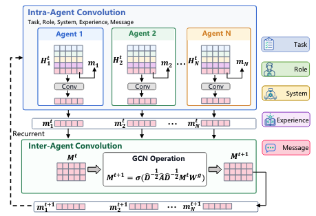
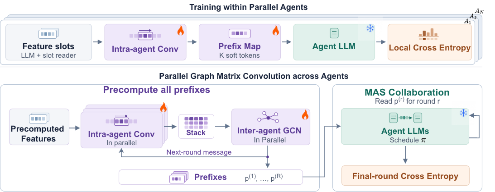

<div align="center">
  
  <h1>OpenJiuwen</h1>
  <p><strong>Convolutional co-evolution for multi-agent language models</strong></p>
  <p>
    <a href="https://github.com/LYA2333/CSI"></a>
    <a href="vendor/recursivemas/LICENSE" title="MIT license for vendored RecursiveMAS"></a>
  </p>
</div>

## Demo

<!-- DEMO START -->


https://github.com/user-attachments/assets/c9509b8d-35ee-45b3-b79b-0dc0c78c2d37


<!-- DEMO END -->

## Overview

**ConvRSI** coordinates frozen language-model agents through learned soft prefixes. Each agent combines its feature slots with a local convolution, and a graph convolution updates the messages across agents. This repository supports **Sequential** and **Mixture** collaboration for two-stage training, MATH-500 evaluation, and single-question math inference.

## Table of contents

- [Collaboration styles](#collaboration-styles)
- [Installation](#installation)
- [Datasets](#datasets)
- [Model](#model)
- [Training](#training)
- [Evaluation and inference](#evaluation-and-inference)
- [Acknowledgements](#acknowledgements)
- [Third-party licenses](#third-party-licenses)

## Collaboration styles

Select the topology with `--mas-system` or its alias `--multi-agent-system`.

| Style | Training flag | Agent schedule | GCN graph | Final answer |
| --- | --- | --- | --- | --- |
| **Sequential** | `--mas-system sequential` | Planner → Critic → Solver | Directed chain | Solver |
| **Mixture** | `--mas-system mixture` | Math, Code, and Science Experts → Summarizer | Bidirectional star | Summarizer |

In **Sequential**, the Solver sends latent feedback to the next round's Planner through an OuterLink. In **Mixture**, the Summarizer reads three separate expert inputs and sends each expert its own latent feedback for the next round. Both graphs include normalized self-loops.

## Installation

Run the commands from the repository root.

```bash
conda create -n convrsi python=3.10 -y
conda activate convrsi
python -m pip install -r requirements.txt
```

The training defaults place all active agents and ConvRSI modules on `cuda:0` and load the backbones in BF16. Use `--<role>-device` and `--csi-device` to change placement, and `--model-dtype float32` on devices that require FP32.

### Backbone weights

| Style | Agent | CLI role | Default path or Hugging Face model ID |
| --- | --- | --- | --- |
| Sequential | Planner | `planner` | `pre-trained/Qwen3-1.7B` |
| Sequential | Critic | `critic` | `pre-trained/Llama-3.2-1B-Instruct` |
| Sequential | Solver | `executor` | `pre-trained/Qwen2.5-Math-1.5B-Instruct` |
| Mixture | Math Expert | `math-expert` | `deepseek-ai/DeepSeek-R1-Distill-Qwen-1.5B` |
| Mixture | Code Expert | `code-expert` | `Qwen/Qwen2.5-Coder-3B-Instruct` |
| Mixture | Science Expert | `science-expert` | `BioMistral/BioMistral-7B` |
| Mixture | Summarizer | `summarizer` | `Qwen/Qwen3.5-2B` |

Place the Sequential model files in the listed directories or set their `--<role>-model-path` flags. Mixture defaults to Hub model IDs and accepts local model directories through the same flags, such as `--science-expert-model-path` and `--summarizer-model-path`.

## Datasets

| Dataset | Use |
| --- | --- |
| Sequential-Math | Sequential training (1,904 rows) |
| Mixture-Outer | Mixture training |
| MATH-500 | Math evaluation for either style (500 rows) |

Download the Mixture training file to the path used in the training example. [Mixture-Outer dataset](https://huggingface.co/datasets/RecursiveMAS/Mixture-Outer)

```bash
python - <<'PY'
from huggingface_hub import hf_hub_download

hf_hub_download(
    repo_id="RecursiveMAS/Mixture-Outer",
    filename="data/train-00000-of-00001.parquet",
    repo_type="dataset",
    local_dir="datasets/Mixture-Outer",
)
PY
```

- **Sequential** rows provide `question`, `plan`, `refined_plan`, and `answer`. The bundled file is the original split and includes six exact matches with MATH-500 after normalizing case and whitespace.
- **Mixture** rows provide `question`, `hie_math_expert`, `hie_code_expert`, `hie_science_expert`, and a Summarizer target in `answer` or `hie_summarizer`. The prompt families are `math`, `choice`, and `code`.

Use `--train-parquet` or `--train-jsonl` to pass the training split explicitly. Each packed sequence must fit the backbone context and the selected `--inner-max-length` or `--max-length` budget. That length includes the prompt, soft prefix, incoming latent states, and reference tokens.

## Model

<p align="center">
  
</p>

**ConvRSI framework.** The figure shows the Sequential roles. Both styles use the same local convolution and graph update with their respective communication graphs.

- **Feature slots.** The frozen backbones encode task, role, system, and experience features once per example in a system forward pass. The default slot reader produces eight slots per feature. The recurrent message starts as a masked zero.
- **Intra-agent Conv.** Depthwise Conv1D mixes feature types independently at each slot. Gated pooling produces each agent's local message.
- **Inter-agent GCN.** The graph aggregates local messages at each slot. With the default GCN feedback, the updated messages supply the current soft prefixes and the next round's message features.
- **Latent collaboration.** InnerLinks and OuterLinks map execution states between agent invocations. The collaboration schedule determines where each latent sequence is consumed.

## Training

<p align="center">
  
</p>

**Two-stage training.** The Inner panel illustrates the optional local cross-entropy objective. The Outer panel shows how GCN feedback allows round prefixes to be precomputed. The training entry point executes Conv–GCN followed by agent collaboration in each round.

| Stage | Objective | Updated modules |
| --- | --- | --- |
| **Inner** | Cosine alignment between transformed detached hidden states and reference-token embeddings by default. Set `--inner-ce-weight 1` to add local token cross-entropy. | InnerLinks for alignment. Local CSI modules receive gradients from the optional CE term. |
| **Outer** | Teacher-forced collaboration with token cross-entropy on the final-round Solver or Summarizer answer. | Local CSI modules, GCN, and OuterLinks. |

Use `--inner-parallel` to train the independent Inner agents concurrently.

### Sequential training

```bash
python train_csi.py \
  --mas-system sequential \
  --train-parquet datasets/Sequential-Math/data/train-00000-of-00001.parquet \
  --inner-epochs 1 --epochs 1 \
  --inner-max-length 4096 \
  --inner-batch-size 2 --batch-size 2 \
  --output-dir runs/sequential
```

### Mixture training

```bash
python train_csi.py \
  --mas-system mixture \
  --train-parquet datasets/Mixture-Outer/data/train-00000-of-00001.parquet \
  --inner-epochs 1 --epochs 1 \
  --inner-max-length 4096 \
  --inner-batch-size 1 --batch-size 1 \
  --output-dir runs/mixture
```

### Common settings

| Flag | Training default | Controls |
| --- | --- | --- |
| `--max-steps` | 3 | Number of Conv–GCN and collaboration rounds |
| `--csi-prefix-tokens` | 8 | Continuous slots per feature and per CSI soft prefix |
| `--d-model` | 512 | Shared convolution and graph width |
| `--max-feature-tokens` | 1024 | Token limit for each static feature input |
| `--max-prefix-tokens` | 80 | Maximum latent positions per transfer during Outer training |
| `--latent-length` | 32 | Latent rollout steps per intermediate invocation at inference |

To enable validation during Outer training, use `--outer-validation --validation-jsonl` with the path to your validation file.

### Checkpoints

Each run writes `csi_latest.pt`, `csi_outer_epoch_*.pt`, `csi_final.pt`, and `token_usage.json`.

| Flag | Use |
| --- | --- |
| `--resume` | Continue a matching run with its optimizer, scheduler, and progress. |
| `--init-checkpoint` | Initialize a new run in the same topology from compatible weights with fresh training state. |
| `--checkpoint-path` | Load a trained checkpoint for evaluation or inference. |

## Evaluation and inference

The evaluator and single-question runner restore the topology from the checkpoint. An explicit `--mas-system` must match the saved topology. Intermediate agent invocations run in latent space. The final Solver or Summarizer decodes the text answer.

### MATH-500 evaluation

Set `system` to `sequential` or `mixture` to select the matching run.

```bash
system=mixture
python evaluate_math500_csi.py \
  --mas-system "$system" \
  --dataset-path datasets/MATH-500/test.jsonl \
  --checkpoint-path "runs/$system/csi_final.pt" \
  --output-dir "runs/$system/math500" \
  --batch-size 1 --grader math_verify
```

The default `after` evaluation writes `after_predictions.jsonl`, `after_predictions_summary.json`, and `summary.json`. Use `--limit` to run on a subset.

### Single-question inference

The same entry point accepts either style's checkpoint.

```bash
python ours_runner.py \
  --checkpoint-path runs/mixture/csi_final.pt \
  --question "Find the sum of the first 20 positive integers."
```

### Shell launchers

| Style | Training and evaluation | Evaluation only |
| --- | --- | --- |
| Sequential | [train.sh](train.sh) | [infer.sh](infer.sh) |
| Mixture | [train_mixture.sh](train_mixture.sh) | [infer_mixture.sh](infer_mixture.sh) |

The launchers contain machine-specific paths. Set `MODEL_DIR`, dataset and checkpoint paths, and the active agent devices for your environment. Create `logs/` and `test_logs/` before using the launchers. In `train_mixture.sh`, set `--train-parquet` to the downloaded shard or your prepared training file.

## Acknowledgements

ConvRSI uses prompts and latent-link components from RecursiveMAS. [Upstream code](https://github.com/RecursiveMAS/RecursiveMAS)

The training and evaluation data come from RecursiveMAS and HuggingFaceH4. [Sequential-Math](https://huggingface.co/datasets/RecursiveMAS/Sequential-Math) · [Mixture-Outer](https://huggingface.co/datasets/RecursiveMAS/Mixture-Outer) · [MATH-500](https://huggingface.co/datasets/HuggingFaceH4/MATH-500)

## Third-party licenses

The vendored RecursiveMAS components carry their MIT license notice. [RecursiveMAS license](vendor/recursivemas/LICENSE)
